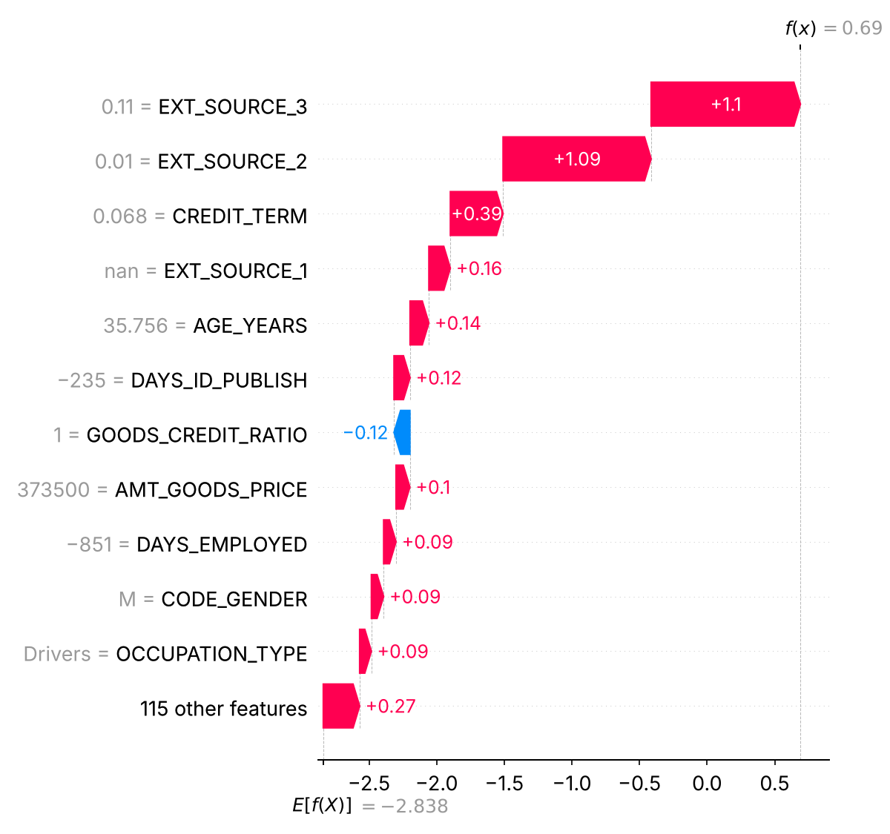

# Prédiction du défaut de crédit et explicabilité SHAP

Modèle de scoring crédit entraîné sur le jeu de données public **Home Credit Default Risk** (Kaggle), avec une couche d'explicabilité **SHAP** pour justifier chaque score, à l'échelle du portefeuille comme à l'échelle d'un client.

Ce projet prolonge mon projet de fin d'études à CY Tech, consacré à la comparaison d'algorithmes d'explicabilité (LIME, SHAP, SLALOM, Integrated Gradients) sur des modèles de langage. Il transpose cette démarche aux données tabulaires, dans un secteur où expliquer une décision est une exigence réglementaire : en crédit, un refus doit pouvoir être motivé auprès du client.

> 🚧 Projet en cours : voir la [feuille de route](#feuille-de-route).

## Objectifs

1. Prédire la probabilité de défaut d'un demandeur de crédit.
2. Évaluer le modèle avec les métriques utilisées en banque : AUC, **Gini**, **KS** et Brier.
3. Expliquer les prédictions avec SHAP :
   - **globalement** : quelles variables pèsent le plus sur le risque, et dans quel sens ;
   - **localement** : les raisons principales du score d'un client donné (*reason codes*).
4. Comparer SHAP et LIME sur la cohérence et la stabilité des explications.

## Données

[Home Credit Default Risk](https://www.kaggle.com/competitions/home-credit-default-risk) : environ 307 000 demandes de crédit, 120 variables, environ **8 % de défauts**. Les données ne sont pas versionnées dans ce repo ; voir [`data/README.md`](data/README.md) pour les télécharger.

## Démarche

| Étape | Choix |
|---|---|
| Nettoyage | Correction de la valeur sentinelle `DAYS_EMPLOYED = 365243`, qui signifie « sans emploi ou retraité » |
| Variables métier | Taux d'effort (mensualité / revenu), endettement (crédit / revenu), durée implicite du prêt, apport, âge |
| Modèle de référence | Régression logistique standardisée, le standard historique du scoring |
| Modèle principal | LightGBM avec arrêt anticipé sur un jeu de validation distinct du jeu de test |
| Explicabilité | `shap.TreeExplainer`, qui calcule des valeurs SHAP exactes pour les modèles d'arbres |

## Résultats

Jeu de test de 61 500 clients (20 % des données, tirage stratifié), entraînement sur la seule table `application_train` :

| Modèle | AUC | Gini | KS | Brier |
|---|---|---|---|---|
| Régression logistique | 0,751 | 0,501 | 0,376 | 0,202* |
| **LightGBM** | **0,770** | **0,540** | **0,404** | **0,067** |

\* La régression logistique est entraînée avec `class_weight="balanced"`, qui gonfle ses probabilités : son score de Brier n'est donc pas comparable. La calibration est prévue dans la feuille de route.

### Explicabilité globale


- Les trois scores externes `EXT_SOURCE_1`, `EXT_SOURCE_2` et `EXT_SOURCE_3` (des notations venant de bureaux de crédit) dominent largement : plus ils sont bas, plus le risque monte.
- Parmi les variables construites, `CREDIT_TERM` (mensualité / montant du crédit, l'inverse de la durée) et `GOODS_CREDIT_RATIO` (part financée par le bien, liée à l'apport) arrivent juste derrière.
- `CODE_GENDER` figure parmi les variables influentes. En crédit, utiliser le sexe pour décider est interdit (principe de non-discrimination). Ce point sera traité dans une étape dédiée à l'équité du modèle.

### Explicabilité locale : le client le plus risqué de l'échantillon



Le graphique décompose le score d'un client, en log-odds, à partir du risque moyen. Chaque barre montre de combien une variable augmente (en rouge) ou diminue (en bleu) son risque. Les trois plus grosses contributions positives donnent les raisons à communiquer en cas de refus.

## Structure

```
├── data/              # données brutes (non versionnées)
├── src/
│   ├── config.py      # chemins et constantes
│   ├── data.py        # chargement et nettoyage
│   ├── features.py    # variables métier
│   ├── train.py       # entraînement et évaluation
│   ├── evaluate.py    # métriques crédit (AUC, Gini, KS, Brier)
│   └── explain.py     # SHAP global et local
├── app/               # application Streamlit (à venir)
├── models/            # modèles entraînés (non versionnés)
└── reports/figures/   # graphiques SHAP
```

## Lancer le projet

```bash
pip install -r requirements.txt
# placer application_train.csv dans data/raw/
python -m src.train            # entraîne et évalue les deux modèles
python -m src.explain          # génère les graphiques SHAP
```

Pour itérer plus vite sur un sous-échantillon : `python -m src.train --sample 50000`.

## Feuille de route

- [x] Pipeline d'entraînement : régression logistique et LightGBM
- [x] Métriques crédit : AUC, Gini, KS, Brier
- [x] SHAP global (beeswarm, importance) et local (waterfall, reason codes)
- [ ] Variables issues des tables `bureau` et `previous_application`
- [ ] Calibration des probabilités
- [ ] Seuil de décision fixé selon le coût d'un défaut face à un refus à tort
- [ ] Comparaison SHAP / LIME et stabilité des explications
- [ ] Équité : retrait des variables sensibles et mesure de l'écart de taux d'acceptation
- [ ] Application Streamlit déployée

## Auteur

**Maxime Alzoubaidy**, ingénieur Data Science (CY Tech)
