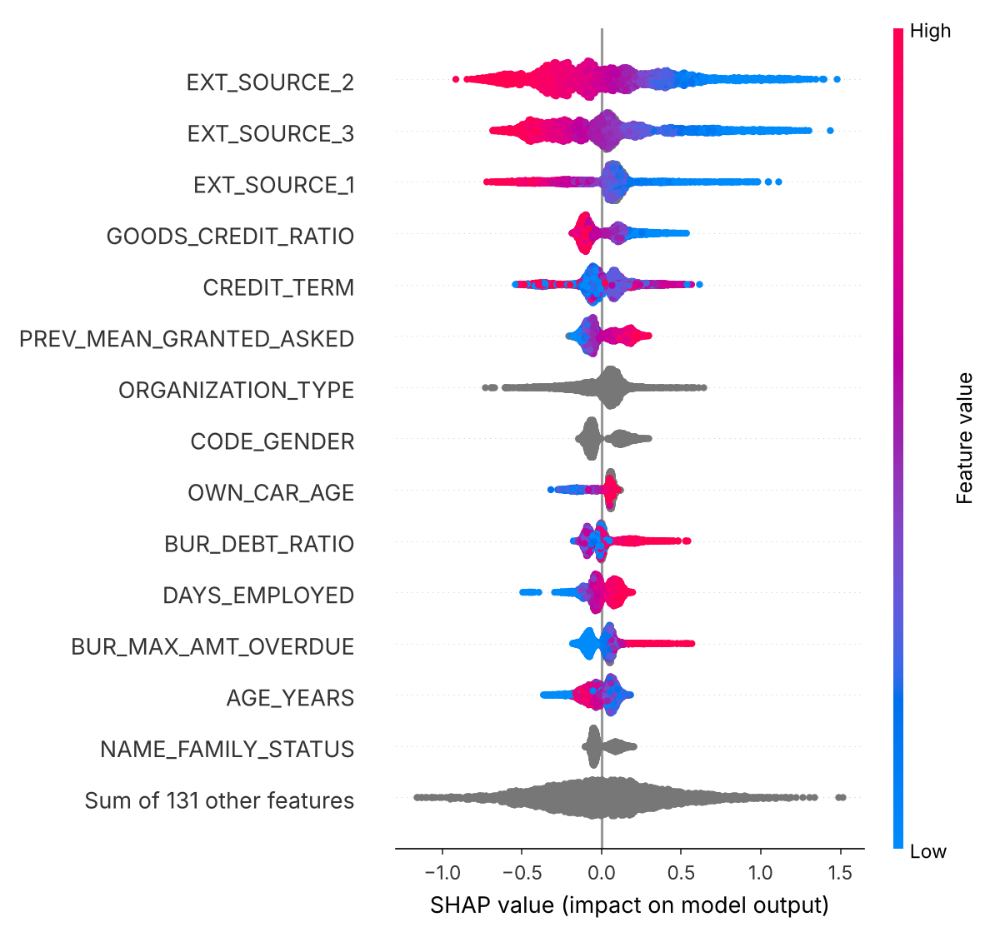
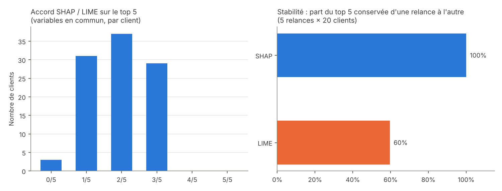
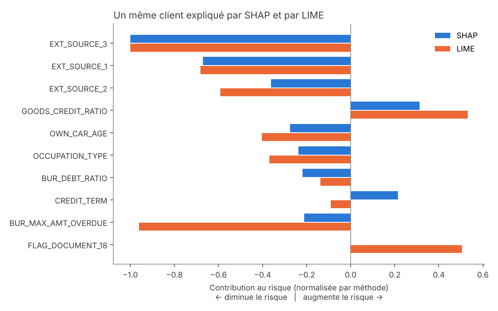

# Prédiction du défaut de crédit et explicabilité SHAP

Modèle de scoring crédit entraîné sur le jeu de données public **Home Credit Default Risk** (Kaggle), avec une couche d'explicabilité **SHAP** pour justifier chaque score, à l'échelle du portefeuille comme à l'échelle d'un client.

Ce projet prolonge mon projet de fin d'études à CY Tech, consacré à la comparaison d'algorithmes d'explicabilité (LIME, SHAP, SLALOM, Integrated Gradients) sur des modèles de langage. Il transpose cette démarche aux données tabulaires, dans un secteur où expliquer une décision est une exigence réglementaire : en crédit, un refus doit pouvoir être motivé auprès du client.

> 🚧 Projet en cours : voir la [feuille de route](#feuille-de-route).

## Objectifs

1. Prédire la probabilité de défaut d'un demandeur de crédit.
2. Évaluer le modèle avec les métriques utilisées en banque : AUC, **Gini**, **KS** et Brier.
3. Expliquer les prédictions avec SHAP :
   - **globalement** : quelles variables pèsent le plus sur le risque, et dans quel sens ;
   - **localement** : les raisons principales du score d'un client donné (*reason codes*).
4. Comparer SHAP et LIME sur la cohérence et la stabilité des explications.

## Données

[Home Credit Default Risk](https://www.kaggle.com/competitions/home-credit-default-risk) : environ 307 000 demandes de crédit, 120 variables, environ **8 % de défauts**. Les données ne sont pas versionnées dans ce repo ; voir [`data/README.md`](data/README.md) pour les télécharger.

## Démarche

| Étape | Choix |
|---|---|
| Nettoyage | Correction de la valeur sentinelle `DAYS_EMPLOYED = 365243`, qui signifie « sans emploi ou retraité » |
| Variables métier | Taux d'effort (mensualité / revenu), endettement (crédit / revenu), durée implicite du prêt, apport, âge |
| Historique de crédit | Une vingtaine d'agrégats lisibles par client, tirés de `bureau` (crédits ailleurs : nombre, dette en cours, retards) et de `previous_application` (demandes passées : refus, taux d'acceptation, montant accordé / demandé) |
| Modèle de référence | Régression logistique standardisée, le standard historique du scoring |
| Modèle principal | LightGBM avec arrêt anticipé sur un jeu de validation distinct du jeu de test |
| Explicabilité | `shap.TreeExplainer`, qui calcule des valeurs SHAP exactes pour les modèles d'arbres |

## Résultats

Jeu de test de 61 500 clients (20 % des données, tirage stratifié), jamais vus pendant l'entraînement :

| Modèle | Données | AUC | Gini | KS | Brier |
|---|---|---|---|---|---|
| Régression logistique | `application` seule | 0,751 | 0,501 | 0,376 | 0,202* |
| LightGBM | `application` seule | 0,770 | 0,540 | 0,404 | 0,067 |
| Régression logistique | + historique de crédit | 0,760 | 0,521 | 0,394 | 0,199* |
| **LightGBM** | **+ historique de crédit** | **0,778** | **0,557** | **0,414** | **0,066** |

\* La régression logistique est entraînée avec `class_weight="balanced"`, qui gonfle ses probabilités : son score de Brier n'est donc pas comparable. La calibration est prévue dans la feuille de route.

### Explicabilité globale



- Les trois scores externes `EXT_SOURCE_1`, `EXT_SOURCE_2` et `EXT_SOURCE_3` (des notations venant de bureaux de crédit) dominent largement : plus ils sont bas, plus le risque monte.
- Parmi les variables construites, `GOODS_CREDIT_RATIO` (part financée par le bien, liée à l'apport) et `CREDIT_TERM` (mensualité / montant du crédit, l'inverse de la durée) arrivent juste derrière.
- L'historique de crédit apporte des signaux intuitifs : plus la part de dette encore due ailleurs (`BUR_DEBT_RATIO`) ou le pire retard passé (`BUR_MAX_AMT_OVERDUE`) sont élevés, plus le risque monte.
- `CODE_GENDER` figure parmi les variables influentes. En crédit, utiliser le sexe pour décider est interdit (principe de non-discrimination). Ce point sera traité dans une étape dédiée à l'équité du modèle.

### Explicabilité locale : le client le plus risqué de l'échantillon


Le graphique décompose le score d'un client, en log-odds, à partir du risque moyen. Chaque barre montre de combien une variable augmente (en rouge) ou diminue (en bleu) son risque. Les trois plus grosses contributions positives donnent les raisons à communiquer en cas de refus.

## SHAP ou LIME : les explications sont-elles fiables ?

Une explication n'est utile que si elle est cohérente et reproductible : deux méthodes sérieuses devraient désigner les mêmes causes, et relancer le calcul ne devrait pas changer la réponse. Mon projet de fin d'études comparait ces méthodes sur des modèles de langage ; je refais l'exercice ici sur le modèle de crédit, avec 100 clients du jeu de test ([`src/compare_explainers.py`](src/compare_explainers.py)).

| Critère | SHAP (TreeExplainer) | LIME |
|---|---|---|
| Stabilité : part du top 5 conservée d'une relance à l'autre | **100 %** (calcul exact) | 60 % |
| Temps par explication | **0,008 s** | 0,34 s (≈ 40× plus lent) |
| Variables en commun dans le top 5 des deux méthodes | 38 % en moyenne | |
| Sens de l'effet sur ces variables communes | identique dans 100 % des cas | |



**Lecture.**
- Quand les deux méthodes retiennent la même variable, elles s'accordent toujours sur le sens de son effet. En revanche, elles ne partagent en moyenne que 2 variables sur 5 dans leur top 5.
- LIME n'est pas reproductible : il explique le modèle à partir d'échantillons tirés au hasard autour du client, si bien que d'une relance à l'autre, 2 des 5 variables principales changent en moyenne. Pour un refus de crédit, qui doit pouvoir être justifié et audité, c'est rédhibitoire.
- SHAP calcule la valeur exacte pour un modèle d'arbres : même réponse à chaque fois, et 40 fois plus vite.



Sur ce client, les deux méthodes s'accordent sur l'essentiel (les scores externes `EXT_SOURCE` font baisser son risque). Mais LIME donne un poids important à `FLAG_DOCUMENT_18`, alors que le client a la valeur la plus courante (0, comme 99 % des clients) et que SHAP lui attribue un effet nul. C'est un artefact typique de l'échantillonnage de LIME.

**Limite de la comparaison.** LIME ne sait pas perturber une valeur manquante. Pour comparer les deux méthodes sur les mêmes points, les clients ont été choisis sans valeur manquante sur les 10 variables les plus importantes, puis leurs autres valeurs manquantes ont été imputées (médiane, ou modalité la plus fréquente).

**Conclusion : SHAP est retenu pour produire les motifs de refus.**

## Structure

```
├── data/              # données brutes (non versionnées)
├── src/
│   ├── config.py      # chemins et constantes
│   ├── data.py        # chargement et nettoyage
│   ├── features.py    # variables métier
│   ├── history.py     # agrégats bureau et previous_application
│   ├── train.py       # entraînement et évaluation
│   ├── evaluate.py    # métriques crédit (AUC, Gini, KS, Brier)
│   ├── explain.py     # SHAP global et local
│   └── compare_explainers.py  # comparaison SHAP / LIME
├── app/               # application Streamlit (à venir)
├── models/            # modèles entraînés (non versionnés)
└── reports/           # métriques (JSON) et figures
```

## Lancer le projet

```bash
pip install -r requirements.txt
# placer application_train.csv, bureau.csv et previous_application.csv dans data/raw/
python -m src.train                 # entraîne et évalue les deux modèles
python -m src.explain               # génère les graphiques SHAP
python -m src.compare_explainers    # compare SHAP et LIME (≈ 1 min)
```

Pour itérer plus vite sur un sous-échantillon : `python -m src.train --sample 50000`.
Pour n'utiliser que `application_train` : `python -m src.train --no-history`.

## Feuille de route

- [x] Pipeline d'entraînement : régression logistique et LightGBM
- [x] Métriques crédit : AUC, Gini, KS, Brier
- [x] SHAP global (beeswarm, importance) et local (waterfall, reason codes)
- [x] Variables issues des tables `bureau` et `previous_application`
- [ ] Calibration des probabilités
- [ ] Seuil de décision fixé selon le coût d'un défaut face à un refus à tort
- [x] Comparaison SHAP / LIME et stabilité des explications
- [ ] Équité : retrait des variables sensibles et mesure de l'écart de taux d'acceptation
- [ ] Application Streamlit déployée

## Auteur

**Maxime Alzoubaidy**, ingénieur Data Science (CY Tech)
